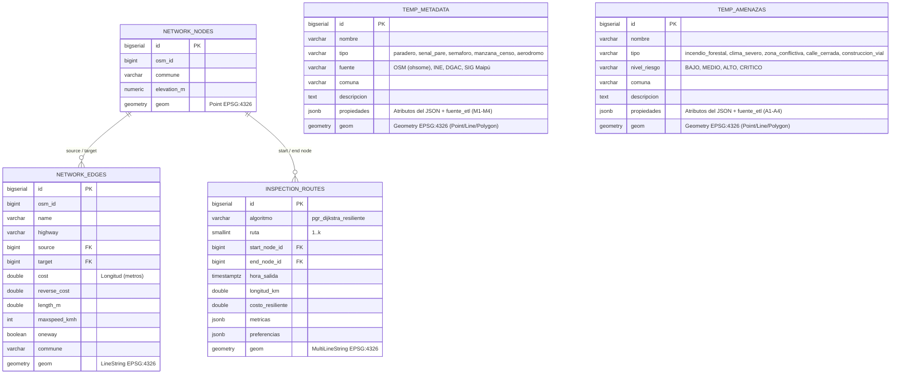

# Diseño y Estructura de la Base de Datos Geoespacial

Este directorio contiene la definición de la base de datos para el proyecto de **Detección de Señaléticas y Elementos Viales con Flota UAV** en las comunas de **Maipú, Estación Central y Santiago**.

---

## 1. Script de creación (`init.sql`)
El archivo [`init.sql`](./init.sql) contiene las sentencias DDL para inicializar la base de datos PostgreSQL con las extensiones **PostGIS** y **pgRouting**. Al iniciar el contenedor de base de datos (`db`) mediante Docker Compose, este script se ejecuta automáticamente en `/docker-entrypoint-initdb.d/`, pero **solo cuando el volumen de datos se crea por primera vez**. Por eso `main.py` lo vuelve a ejecutar al inicio de cada pipeline: todas las sentencias son idempotentes (`IF NOT EXISTS`, `CREATE OR REPLACE`), así una BD ya existente recibe los cambios del esquema sin perder datos.

---

## 2. Diagrama Entidad-Relación (Estructura Flexible)

Para el módulo de ETL y visualización, la base de datos se diseñó con un núcleo topológico estricto para **pgRouting** y tablas flexibles (`JSONB` + `geometry(Geometry, 4326)`) para **Metadata** y **Amenazas**. Esto permite extraer, transformar y cargar datos de diversas fuentes sin que el equipo quede atado a columnas fijas antes de consolidar el análisis.

---

## 3. Justificación Técnica del Diseño

1. **Infraestructura (`network_nodes`, `network_edges`)**:
   - Sigue la topología que requiere **pgRouting** (`source`, `target`, `cost`, `reverse_cost`) para ejecutar `pgr_dijkstra`.
   - El atributo `cost` es la longitud en metros (`length_m`): es el costo base, sin amenazas ni metadata. El ruteo no lo modifica; calcula los pesos resilientes $w(e)$ en cada consulta (ver sección 4).

2. **Tablas Temporales/Genéricas (`temp_metadata` y `temp_amenazas`)**:
   - **`geom geometry(Geometry, 4326)`**: Permite almacenar puntos (paraderos, señales, reportes), líneas o polígonos (manzanas, celdas de clima, geocercas de exclusión) en la misma tabla sin restricciones.
   - **`propiedades JSONB`**: Permite cargar cualquier estructura de atributos extraída de APIs o archivos JSON sin necesidad de alterar el esquema SQL por cada nueva fuente.
   - **`propiedades->>'fuente_etl'`**: Identifica la fuente de cada fila (`M1_paraderos`, `M2_controles_viales`, `M3_censo_manzanas`, `M4_aerodromos`, `A1_incendios`, `A2_clima`, `A3_sosafe`, `A4_waze`). Cada `cargar.py` borra las filas de su fuente antes de insertar (carga idempotente), y el ruteo y la API filtran por ella, por lo que tiene un índice de expresión propio en ambas tablas.
   - **Extensibilidad futura**: Una vez consolidadas las fuentes definitivas con el equipo, estas tablas se pueden normalizar a tablas especializadas.

3. **Rutas (`inspection_routes`)**:
   - Tiene la forma de las k rutas que entrega `GET /api/rutas`: número de ruta, hora de salida, longitud, costo resiliente, métricas y preferencias en `JSONB`, y la geometría `MultiLineString`.
   - Por ahora las rutas se calculan bajo demanda y la tabla queda vacía; `Infraestructura/cargar.py` la vacía al recargar la red porque referencia a `network_nodes`.
   - Al aplicar el esquema, si existe la versión anterior (una sola ruta baseline con `costo_total`), se elimina y se recrea con la forma nueva.

4. **Pesos resilientes (`pesos_ruteo`, tabla temporal)**:
   - No forma parte de `init.sql`. `docker/web/ruteo/dijkstra_k.py` la crea en cada consulta de ruteo como tabla temporal de la sesión (`id`, `factor`, `uso`) y la descarta al terminar.
   - `factor = -1` marca una arista bloqueada (amenaza dura o aeródromo); en otro caso multiplica el largo. `uso` cuenta cuántas rutas previas usaron la arista, para generar las k alternativas. El detalle está en [`docker/web/ruteo/README.md`](../docker/web/ruteo/README.md).

5. **Función `fn_calculate_baseline_dijkstra_route`**:
   - Ruta más corta con `pgr_dijkstra` solo por `cost` (longitud), sin pesos resilientes. Sirve para comprobar que el grafo funciona (`SELECT * FROM fn_calculate_baseline_dijkstra_route(1, 100);`).
