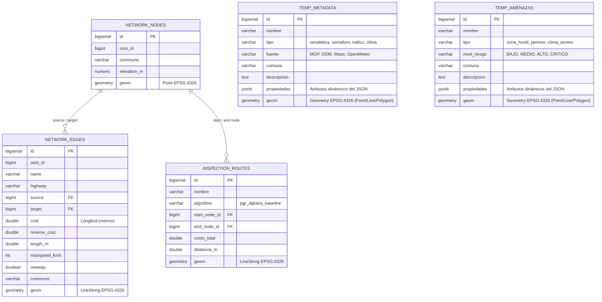

# Diseño y Estructura de la Base de Datos Geoespacial

Este directorio contiene la definición de la base de datos para el proyecto de **Detección de Señaléticas y Elementos Viales con Flota UAV** en las comunas de **Maipú, Estación Central y Santiago**.

---

## 1. Archivo SQL de Creación desde Cero
El archivo [`init.sql`](./init.sql) contiene las sentencias DDL para inicializar la base de datos PostgreSQL con las extensiones **PostGIS** y **pgRouting**. Al iniciar el contenedor de base de datos (`db`) mediante Docker Compose, este script se ejecuta automáticamente en `/docker-entrypoint-initdb.d/`.

---

## 2. Diagrama Entidad-Relación (Estructura Flexible)

Para el módulo de ETL y visualización, la base de datos se diseñó con un núcleo topológico estricto para **pgRouting** y tablas flexibles (`JSONB` + `geometry(Geometry, 4326)`) para **Metadata** y **Amenazas**. Esto permite extraer, transformar y cargar datos de diversas fuentes sin que el equipo quede atado a columnas fijas antes de consolidar el análisis.

---

## 3. Justificación Técnica del Diseño

1. **Infraestructura (`network_nodes`, `network_edges`)**:
   - Cumple con la topología estricta requerida por **pgRouting** para ejecutar `pgr_dijkstra`.
   - El atributo `cost` es la longitud en metros (`length_m`), cumpliendo con la ruta **peor caso** (baseline sin costos multivariables).

2. **Tablas Temporales/Genéricas (`temp_metadata` y `temp_amenazas`)**:
   - **`geom geometry(Geometry, 4326)`**: Permite almacenar puntos (señales, jammers), líneas (tráfico Waze) o polígonos (zonas hostiles, áreas de lluvia) en la misma tabla sin restricciones.
   - **`propiedades JSONB`**: Permite cargar cualquier estructura de atributos extraída de APIs o archivos JSON sin necesidad de alterar el esquema SQL por cada nueva fuente.
   - **Extensibilidad futura**: Una vez consolidadas las fuentes definitivas con el equipo, estas tablas se pueden normalizar a tablas especializadas.

3. **Ruteo Baseline (`inspection_routes` y `fn_calculate_baseline_dijkstra_route`)**:
   - Implementa la función que resuelve la ruta base con `pgr_dijkstra` para ser consumida y graficada por Leaflet en el sitio web.
